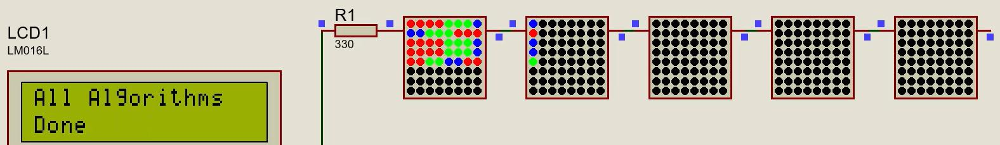
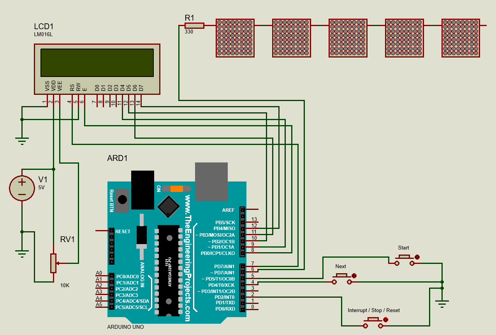
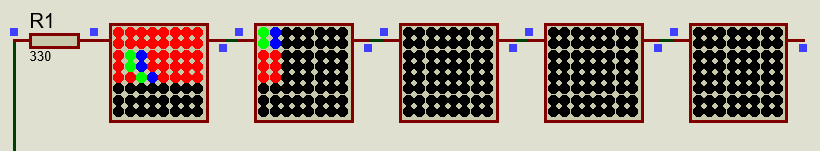
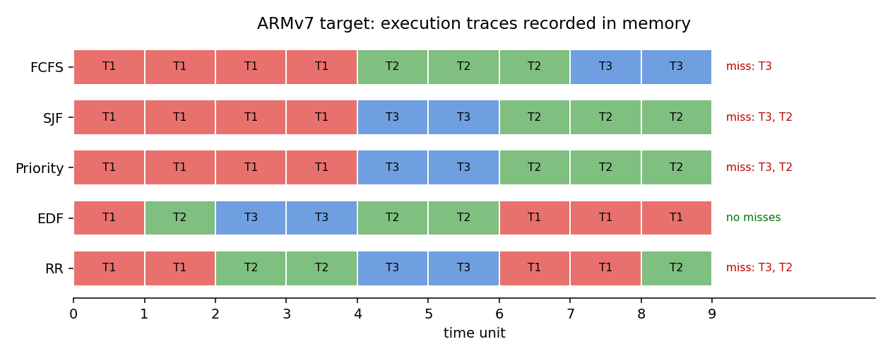
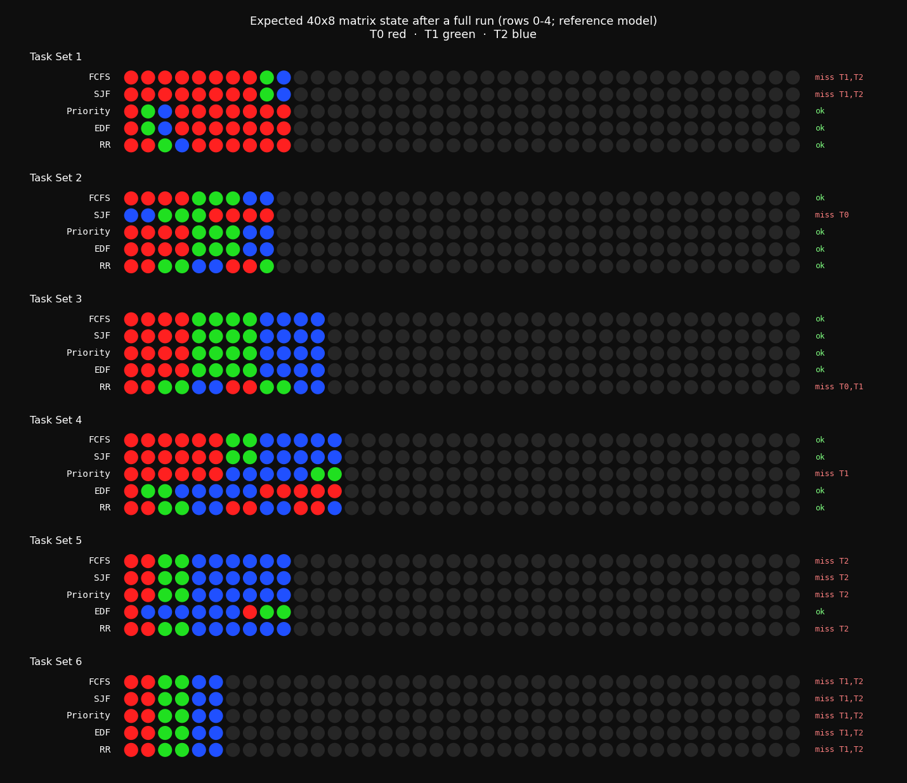

# SchedScope

**A discrete-time CPU scheduling visualization and analysis platform for small embedded targets.**

SchedScope is an embedded scheduling visualization platform that makes CPU scheduling decisions observable instead of only showing final results. It runs classical scheduling algorithms on identical workloads and visualizes their execution behavior on resource-constrained systems.

On an ATmega328P-based platform, scheduling decisions are displayed live using a 40×8 WS2812 LED matrix as a hardware Gantt chart. A second implementation uses ARMv7 assembly to execute the same scheduling policies and store execution traces directly in memory.



> **Scope:** SchedScope is a scheduling simulator evaluated in simulation environments. The AVR implementation is simulated in Proteus 8, and the ARMv7 implementation is tested in CPUlator. It is not an RTOS and does not schedule real concurrent applications.

---

# Overview

CPU scheduling algorithms are usually analyzed using offline Gantt charts or desktop simulations. While these approaches show the final execution order, they hide the decision process of the scheduler.

SchedScope focuses on making those decisions visible during execution.

The platform provides:

- Live visualization of scheduling decisions on an embedded target.
- Comparison of multiple scheduling policies using identical workloads.
- A low-level ARMv7 implementation for memory-based execution analysis.
- A Python reference model for generating expected traces and cross-checking results.

---

# Features

- Implementation of five classical CPU scheduling policies:
  - FCFS
  - SJF
  - Priority Scheduling
  - EDF
  - Round Robin

- ATmega328P-based embedded visualization platform.

- Live Gantt chart rendering using:
  - 5 × WS2812 8×8 LED panels
  - 40×8 LED visualization canvas

- LCD-based execution monitoring.

- Interrupt-driven reset mechanism using ATmega328P external interrupt INT0.

- Bare-metal ARMv7 assembly implementation with memory-based execution traces.

- Host-side Python reference model for trace comparison.

---

# System Concept

```
              Workload
                  │
                  ▼
 ┌─────────────────────────────────┐
 │  Discrete-Time Scheduling Engine │
 │                                 │
 │ select → execute → update       │
 │         → check deadlines       │
 └───────────────┬─────────────────┘
                 │
          Dispatch Trace
                 │
       ┌─────────┴─────────┐
       ▼                   ▼

  AVR Target          ARMv7 Target

 LED Matrix + LCD     Memory Trace
 Live Visualization   Assembly Analysis
```

The scheduler operates using a discrete logical clock. At each time step, one scheduling decision is made, the selected task receives one CPU unit, and the system updates task states and deadline information.

Each task is represented as:

$$
\tau = \{ID, arrival, duration, deadline, priority\}
$$

A deadline miss occurs when a task completes after its absolute deadline. The scheduler records the event and continues execution.

---

# Scheduling Policies

| Policy | Preemption | Selection Rule |
|---|---|---|
| FCFS | No | Earliest arrival |
| SJF | No | Shortest ready task |
| Priority | Yes | Lowest priority number |
| EDF | Yes | Earliest absolute deadline |
| Round Robin | Yes | FIFO queue with quantum Q = 2 |

---

# Architecture

## AVR Target: Embedded Visualization Platform

The AVR implementation uses an ATmega328P-based Arduino Uno model simulated in Proteus 8.

### Hardware Components

| Component | Description |
|---|---|
| Controller | ATmega328P |
| Gantt Display | 5 × WS2812 8×8 LED panels |
| Status Display | 16×2 LCD |
| NEXT Button | Workload selection |
| START Button | Scheduler execution |
| RESET Button | INT0 interrupt reset |

The LED matrix represents scheduling execution:

- Rows represent scheduling policies.
- Columns represent time units.
- Colors represent task execution.

```
Row 0 → FCFS
Row 1 → SJF
Row 2 → Priority
Row 3 → EDF
Row 4 → Round Robin
```



---

## ARMv7 Target: Assembly Implementation

The ARMv7 version implements the same scheduling policies using bare-metal assembly.

Execution results are stored in dedicated memory regions:

```
<policy>_output
    Task execution trace

<policy>_output_length
    Number of valid trace entries

<policy>_deadline_miss
    Deadline miss records

<policy>_deadline_miss_count
    Number of detected misses
```

The implementation uses no stack and no subroutine calls. Shared operations are handled using assembly macros.

---

# Implementation Details

## Scheduling Engine

At every scheduling step:

1. Ready tasks are identified.
2. The selected scheduling policy chooses the next task.
3. One execution unit is assigned.
4. Task states are updated.
5. Deadline conditions are checked.
6. Execution trace is stored.

---

## Interrupt Handling

The AVR implementation uses two input mechanisms:

- Polling for navigation buttons.
- External interrupt INT0 for reset.

The interrupt service routine only sets a flag. Display updates and system reset operations are performed outside interrupt context.

---

# Demonstration

## Live Execution



## ARMv7 Execution Trace

The ARMv7 implementation stores scheduler traces in memory. The following visualization shows the generated execution timeline and detected deadline misses.



---

## Reference Model Output

The Python reference model reproduces expected scheduling traces and provides a comparison point for both implementations.



Run:

```bash
python3 tools/reference_model.py
```

For ARMv7 workload:

```bash
python3 tools/reference_model.py --armv7
```

---

# Getting Started

## AVR Simulation (Proteus 8)

1. Install required Arduino Uno and WS2812 libraries for Proteus.
2. Open:

```
hardware/proteus/schedscope.pdsprj
```

3. Configure the Arduino program file:

```
firmware/avr/prebuilt/schedscope_avr.ino.hex
```

4. Run the simulation.

Controls:

- NEXT → Select workload
- START → Run scheduling algorithms
- RESET → Abort or clear execution

---

## ARMv7 Simulation (CPUlator)

1. Open CPUlator.
2. Select ARMv7 architecture.
3. Load:

```
asm/armv7/schedscope.s
```

4. Compile and run.
5. Inspect memory regions containing execution traces.

---

# Repository Structure

```
schedscope/

├── firmware/
│   └── avr/
│       ├── schedscope_avr/
│       │   └── schedscope_avr.ino
│       └── prebuilt/
│           └── schedscope_avr.ino.hex

├── hardware/
│   └── proteus/
│       └── schedscope.pdsprj

├── asm/
│   └── armv7/
│       └── schedscope.s

├── tools/
│   └── reference_model.py

└── docs/
```

---

# Documentation

Additional documentation:

- Architecture
- Task model
- Scheduling policies
- Execution flow
- Memory layout
- Interrupt handling
- Visualization
- Results and verification

---

# Known Limitations

- The project is evaluated through simulation environments.
- AVR timing uses a logical clock rather than a hardware timer.
- AVR reports the first deadline miss per policy on LCD.
- ARMv7 workload size and trace buffer size are fixed.
- Workloads are currently defined as compile-time constants.

---

# License

This project is licensed under the MIT License. See the [LICENSE](LICENSE) file for details.
